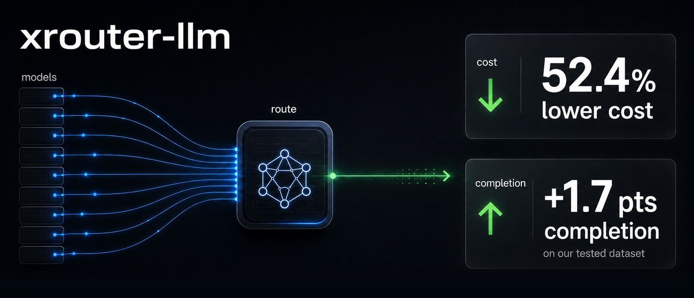

<div align="center">


# xrouter-llm



</div>

Stop sending every prompt to your most expensive LLM.

`xrouter-llm` is a prompt-aware LLM **routing-decision** service: it predicts
which models can complete a prompt, then chooses the cheapest model that clears
the bar. On our tested dataset, it cuts realized cost by **53.2%** while
improving completion by **+1.9 pts**.

It answers "which model should serve this prompt?" and records the choice — it
does NOT call the underlying LLMs.

## Install

```bash
pip install xrouter-llm        # ships a trained router + model registry
# or, for development:
pip install -e ".[dev]"
```

The wheel bundles a trained router artifact, the model-profile registry, and the
router configs, so a fresh install can serve immediately with no extra files.

## Serve

The bundled router, registry, and configs are the defaults, so a bare invocation
works out of the box:

```bash
xrouter-llm serve --port 8080
```

Override any of them to use your own trained model or registry:

```bash
xrouter-llm serve \
  --model artifacts/models/irt_router_350k.joblib \
  --models-dir path/to/models --routers-dir path/to/routers \
  --db artifacts/calls.db --port 8080
```

- `GET /` — single-page UI (prompt box, config picker, decision table, history)
- `GET /api/configs`, `POST /api/route`
  (`{prompt, config, task?, preferred_input_modalities?}`),
  `GET /api/history?limit=N`
- Route candidates include their `input_modalities`; responses also report
  whether the requested input-modality preference narrowed the candidate pool.
- Every decision is logged to SQLite (`*.db`/`*.sqlite` are gitignored — the log
  holds user prompts).

### Xinference embeddings

`IRTRouter` can use a Xinference embedding model through its OpenAI-compatible
`/v1/embeddings` endpoint. For best calibration, train the router with the same
embedding backend you will serve:

```bash
PYTHONPATH=src python3 -m xrouter_llm.cli train-irt \
  --embedding-backend xinference \
  --embedding-model bge-m3 \
  --xinference-base-url http://127.0.0.1:9997/v1 \
  --dataset llmrouterbench:data/raw/llmrouterbench_stream_sample_350k \
  --benchmark-profiles artifacts/profiles/llmrouterbench_350k_profiles.json,src/xrouter_llm/resources/config/models \
  --output artifacts/models/irt_router_xinference.joblib
```

If the loaded artifact was trained with the same embedding model/dimension, the
serve command can replace the serialized backend at startup:

```bash
xrouter-llm serve \
  --model artifacts/models/irt_router_xinference.joblib \
  --override-embedding-backend \
  --embedding-backend xinference \
  --embedding-model bge-m3 \
  --xinference-base-url http://127.0.0.1:9997/v1
```

Programs that build a `RoutingService` themselves can do the same rebind
without going through the CLI. Pass any `EmbeddingBackend` as
`embedding_backend=`, or let the environment choose one:

```python
from xrouter_llm import RoutingService, embedding_backend_from_env

service = RoutingService(
    predictor,
    profiles=profiles,
    configs=configs,
    store=store,
    embedding_backend=embedding_backend_from_env(),
)
```

`embedding_backend_from_env()` reads `XROUTER_EMBEDDING_BACKEND`
(`sentence-transformers` or `xinference`; unset keeps the backend serialized in
the artifact), `XROUTER_EMBEDDING_MODEL` (default `Qwen/Qwen3-Embedding-0.6B`),
and for Xinference `XINFERENCE_BASE_URL` and `XINFERENCE_API_KEY`. The remote
service must serve the same embedding model the artifact was trained with; the
rebind only changes where the vectors are computed, which keeps the in-process
model out of every serving process.

## Model registry

One YAML per supported model, bundled under
`src/xrouter_llm/resources/config/models/` (capability profile: provider, costs,
context, published benchmarks as 0-100 percentages). `model_id` is the model's
canonical OpenRouter slug (e.g. `anthropic/claude-opus-5`). The bundled
registry is the default for `--benchmark-profiles`; point it at your own
directory or file to extend it. Add a model = add a file.

The October 26, 2026 refresh includes 41 profiles. New entries cover Kimi K3.1
Pro, MiniMax M3.1 Flash, DeepSeek V4.1 Flash 1017, Gemini 4 Argon, Claude Haiku
5.5, Mistral Large 4, and Step 5 Preview. Prices and serving limits use the
standard official-provider endpoint, rather than reseller minima or Flex rates.
Each profile records its sources. GPT-5.6 Sol's standard price is now $4/$20
per million input/output tokens; the $2/$10 rate is Flex.

Step 5 Preview joins `auto` and `quality-pair` with its official High-effort
GPQA Diamond score (93.5%). The other six additions lack verified GPQA Diamond
or LiveCodeBench scores for their exact revisions and remain outside bundled
candidate sets. Their benchmark mappings are empty; explicitly selecting them
uses the fitted training-mean capability, not a measured model capability.
Agentic benchmark scores are not substituted for the router's capability inputs.

DeepSeek's `deepseek-flash` alias now resolves to the 1017 profile. Its September
canonical ID remains registered with historical scores and rates for existing
bindings; it is not an alias for 1017. Do not transfer the old GPQA score to the
new checkpoint. `cheap-pair` now uses Gemini 3.1 Flash Lite and GLM 5.3 Flash.

Five older profiles remain as compatibility records: DeepSeek V4.1 Flash,
Gemini 3.5/3.7 Flash, GLM 5.2, and GPT-5.4 Mini. They are excluded from all
bundled router candidate sets, but stay in `known_model_ids()` with their original
modalities so saved XAgent Auto configurations and custom routers still validate.
No database migration is required for this registry update. Retaining an ID does
not guarantee its provider endpoint remains available; callers should explicitly
rebind upgraded endpoints to the matching new profile when appropriate.

Existing exclusions remain: Claude Sonnet/Opus 5.5, GPT-6.1 Sol, GPT-6 Luna,
Grok 4.7, GLM-5.3 FlashX and MiMo-V2.6 Pro/Flash lack verified capability inputs
in this registry. Fable 5.1's published evaluation allows fallback to another
model. Other older candidates remain where they still have official endpoints
and measured capability inputs that their successors currently lack.

Profiles with time-varying provider prices can define `utc_price_overrides`.
Serving resolves the active input/output rate once per request using the current
UTC time; the scalar `input_cost_per_1k` / `output_cost_per_1k` values remain the
fallback outside those windows. Windows are start-inclusive and end-exclusive,
and cannot use the same start and end time. Windows without `utc_days` may wrap
across midnight. Optional `utc_days` entries use full weekday names; omitted
means every day. A weekday-scoped window cannot wrap across midnight; split it
into separate windows on the adjacent UTC days. Windows whose day sets intersect
must not overlap. Quote YAML clock values (for example, `"01:00"`) for
portability; the loader also accepts PyYAML's unquoted sexagesimal representation
as minutes since midnight.

Offline evaluation deliberately uses the scalar fallback price so repeated runs
remain deterministic. For profiles whose scalar is an off-peak rate, offline
decision cost therefore understates peak-hour serving cost and may produce a
different routing distribution from production during those windows.

```python
from xrouter_llm import IRTRouter, default_model_path, default_models_dir, load_benchmark_profiles

router = IRTRouter.load(default_model_path())
for profile in load_benchmark_profiles(default_models_dir()).profiles():
    router.add_benchmark_profile(profile)

preds = router.predict(
    "Design a distributed consensus algorithm",
    model_ids=["anthropic/claude-opus-5", "z-ai/glm-5.3-flash"],
)
print({p.model_id: round(p.mu, 3) for p in preds})
```

## How it works

```text
Do not train:  prompt -> selected model
Train:         prompt + model -> probability the model completes the prompt
Decide:        predicted completion + cost -> cheapest model that can complete
```

Completion is factored into two decoupled axes (an IRT-style model):

```text
P(complete) = sigmoid(a * capability(model) + b * difficulty(prompt) + c)
```

- **capability(model)** = the mean of the model's published `gpqa_diamond` and
  `livecodebench` (both full-coverage on the training side). Going wider doesn't
  help at this data scale — a flat mean dilutes and learned weights overfit at
  37 profiled models; see AGENTS.md "Capability benchmarks". Used directly, so a
  brand-new model's benchmarks drive its ranking.
- **difficulty(prompt)** = a Ridge regressor on a multilingual embedding
  (`Qwen/Qwen3-Embedding-0.6B`), trained on each prompt's empirical pass-rate.
  Multilingual (Chinese transfers from English training data). Picked over
  `bge-m3` by a controlled probe (`scripts/probe_qwen_difficulty.py`): higher
  held-out Pearson and it no longer rates trivial prompts ("1+1=?") as maximally
  hard.

This factoring is the key lesson: a single joint classifier could not rank
unseen models by their benchmarks (on this data, model capability barely
explains completion *marginally* — but it does once difficulty is controlled,
which is exactly what the factored model exploits).

## Datasets

The production difficulty model is trained on **multiple datasets combined**
(all feed the difficulty axis; only profiled models feed the capability axis):

| Source | Type | Scale | In production train? |
| --- | --- | --- | --- |
| `NPULH/LLMRouterBench` (350k stream sample) | single-turn QA / code / math (22 tasks) | 37 models x ~13.8k prompts | ✅ |
| agent-psychometrics — Terminal-Bench 2.0 | terminal agent | 89 tasks x 112 subjects | ✅ `--dataset agentic:agentic/terminalbench` |
| agent-psychometrics — SWE-bench Verified | coding agent | 500 tasks x 134 subjects | ✅ task text joined from `princeton-nlp/SWE-bench_Verified` |
| `Xorbits/xagent-xrouter-labels` | real xagent internal prompts | 100 prompts x 4 OpenRouter models | ✅ `--dataset xagent-labels:Xorbits/xagent-xrouter-labels:full` |
| agent-psychometrics — SWE-bench Pro / GSO | coding agent | 730x14 / 102x15 | ⛔ ship no local task text, external join needed |

The current artifact trains on LLMRouterBench 350k **+ Terminal-Bench +
SWE-bench Verified + xagent labels** (378,397 rows / ~14,463 prompts /
287 subjects). The
agentic matrices come from
[agent-psychometrics](https://github.com/dariakryvosheieva/agent-psychometrics)
(MIT) via `agentic.py`. In `IRTRouter`, only the 37 profiled llmrouterbench
models feed the capability axis and agentic subjects feed difficulty only. RouterBench
(`withmartian/routerbench`) remains a smaller legacy baseline. Local datasets and
trained artifacts are not committed (`data/`, `artifacts/` are gitignored).

Adding more agentic prompt types (e.g. your own traffic) is the only way to make
difficulty accurate for task mixes outside coding/terminal — see AGENTS.md.

## Train

```bash
xrouter-llm train-irt \
  --dataset llmrouterbench:data/raw/llmrouterbench_stream_sample_350k \
  --dataset agentic:agentic/terminalbench \
  --dataset agentic:agentic/swebench_verified \
  --dataset xagent-labels:Xorbits/xagent-xrouter-labels:full \
  --benchmark-profiles artifacts/profiles/llmrouterbench_350k_profiles_priority_collected.json,src/xrouter_llm/resources/config/models \
  --output artifacts/models/irt_router_350k.joblib
```

Diagnostics: `sweep-thresholds` (cost/completion frontier + calibration) and
`eval-model-holdout` (leave-one-model-out generalization).

## Components

- `IRTRouter` (`irt_router.py`): conservative production baseline
  (difficulty x capability).
- `RoutingPolicy` (`policy.py`): "cheapest model whose predicted completion
  clears `completion_threshold`; else the cheapest within `fallback_quality_margin`
  of the best predicted completion".
- `serving.py` / `server.py`: HTTP routing-decision API + single-page web UI.
- `resources/config/models/`: a per-model YAML registry of capability profiles
  and supported input modalities. Routing can prefer compatible models while
  falling back to the full candidate set when none match (bundled in the
  package; resolve with `default_models_dir()`).
- `resources/config/routers/`: named "auto configs" — a candidate model set +
  policy (bundled; `default_routers_dir()`).
- `resources/models/irt_router_350k.joblib`: the trained router shipped with the
  package (`default_model_path()`).

## License

`xrouter-llm` is released under the **Xagent Source License** (© Xorbits Inc.) —
see [LICENSE](LICENSE). It is source-available, **not** an OSI-approved open
source license.

The license text is shared verbatim with [Xagent](https://github.com/xorbitsai/xagent);
for this project the licensed "Software" is `xrouter-llm`, and the
"Restricted Functionality" / hosted-service and competitive-use clauses apply to
its routing-decision and model-selection capabilities. In short: use,
modification, and internal/single-tenant deployment are permitted; offering it as
a multi-tenant hosted/managed service, or a directly competing service, is not.
See [LICENSE](LICENSE) for the controlling terms.
